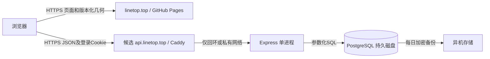

# LineTop｜当前设计（2026-11-13）

## 2026-11-13：前端复用包（本轮用户授权）

用户要求将完整界面、按钮等打包，允许参照其他项目选择复用方式。采用静态 Starter 模板 ZIP：从当前工作区导出 public、必要生成器和测试，补入真实组件示例页、组件依赖说明、来源记录与文件 SHA-256 清单；不改现站源码，不改框架，不发布 npm 或创建远程仓库。ZIP 可解压作新项目，也可按说明提取局部组件。

Agent选择依据：HTML5 Boilerplate将可用模板与开发仓库分开，并提供ZIP/模板仓库；GitHub模板仓库复制目录和文件。单HTML不适合当前GeoJSON fetch、多页面和ESM结构；npm/Web Components需要另行拆分现有DOM/样式耦合，超出本轮。方案采用用户授权的自行选型，不表示用户指定了具体工具。参考：<https://github.com/h5bp/html5-boilerplate>、<https://docs.github.com/en/repositories/creating-and-managing-repositories/creating-a-repository-from-a-template>。

产物为 dist/linetop-frontend-starter.zip，生成源码在 scripts/export-frontend.py 与 templates/frontend。保留原界面和示例内容/头像，说明替换方法；省略原CNAME、Git历史、项目交接和日志。支持导出时设置storage-prefix以隔离同origin不同项目的偏好，只调整导出副本的存储键及对应测试。保留第三方来源和已有许可，不给未明确许可的原内容擅自追加开源授权。完整复制是起点模板，不承诺框架无关的独立组件库或自动同步上游修改。

验证：先定义导出合同测试，再检查包内容/哈希/拒绝覆盖/前缀参数、ZIP独立解压运行、两份Node检查、地图及组件页浏览器交互、原站public全文件哈希不变。当前工作区已有目录迁移未提交，全部保护；不提交、推送或部署。

## 2026-11-13：目录维护（用户已授权实施）

这是本地目录迁移，产品视觉、功能及后端提案不变。静态站的磁盘根为 `public/`，页面、assets、data、CNAME 保持原 URL 相对关系；头像改为 `public/assets/images/avatar.jpg`。生成器留在 scripts，测试移到 tests，原始参考移到 docs/references，验证报告移到 docs/verification，本地证据按 logs/qa/research/scratch/maintenance 分类存入 artifacts。唯一当前设计就是本文，不新建竞争规范。README 负责协作入口与运行说明，发布时只取 public 内容；本轮不改线上配置。以下调查的原路径、受测指纹和命令属于历史语境，不能代替当前验证。

## 2026-11-11：后端阶段一方案（Agent 提案，待用户确认；未实施）

本节是后端工作的唯一设计入口；以下既有前端设计继续有效。本轮用户要求只交付检查、架构与部署选型；不得安装依赖、搭建后端、修改产品代码或自动进入下一阶段。方案确认不等于购买、创建资源、仓库授权、DNS、提交、推送或上线授权。后续提到的目录、表、接口与命令都是拟议契约，目前尚不存在。

### A. 已核实的现状

- 2026-11-11 开工 HEAD 为 `58458c2`，分支 `main`；origin 为 `https://github.com/linefantasy/linefantasy.github.io.git`。暂存区为空。已有 `docs/WORK_STATUS.md` 的23行修改和未跟踪 `docs/推送教程.txt`，原样保护。
- 根目录仍为静态 HTML/CSS/JavaScript，无 package.json、后端程序、数据库迁移或仓库内 `.github` 工作流。没有查 GitHub 账户 Pages 设置，不能断言当前发布分支/构建方式。
- 实时 DNS：`linetop.top` 的四个 A 为 `185.199.108.153` 至 `185.199.111.153`，`www.linetop.top` CNAME 为 `linefantasy.github.io`。首页及 `/map.html` HTTPS HEAD 均200、`server: GitHub.com`。结合仓库及 CNAME，可确认公开前端使用 GitHub Pages；本轮未做浏览器交互或国内多网络测速。`api.linetop.top` 本次本机 DNS 查询为 NXDOMAIN，只是候选地址。
- `map-data-service.mjs` 当前读取同源 manifest、GeoJSON、catalog、schema；有15秒超时、Promise缓存、失败删除缓存、显式clear重试；`detail()`同步读取内存。`map-explorer.mjs`通过名称/要素ID过滤选择器，URL/history v2保存地图、投影和要素ID。
- 四图实读：世界239、中国34、美国51、日本47，共371要素；各图catalog与geometry ID集合一致，没有重复ID或缺失映射。统计371项全为null，图片全为空数组；不能从几何推导真实人口、GDP、统计面积。
- 标识实例：世界`CHN`，中国`CN-JL/CN-TW/CN-HK/CN-MO`，美国`US-DC`，日本`JP-01`。sourceId有数字NE_ID和字符串shapeID，入库必须统一按文本保留。不能把CHN源shapeISO当中国省份唯一标识。
- 港澳台世界几何已并入CHN，旧世界`TWN/HKG/MAC`链接归到CHN；中国图34区保留。困难边界继续暂缓，数据库导入不是边界重新认证。
- `scripts/build-map-page.py`读取index共享壳及`assets/maps/map-page.template.html`生成map.html，并更新index资源指纹和地图ESM依赖指纹。阶段三必须同步模板并使用既有生成流程，不能只改产物。

### B. 四个组成部分与技术选择

前端托管负责把HTML、样式、脚本、GeoJSON交给浏览器；后端运行环境负责持续运行程序、验证登录和处理请求；数据库负责长期保存地区资料、账号与会话；域名/DNS负责把好记的名字指向服务，HTTPS证书负责连接加密。域名本身不提供后端或数据库。

GitHub Pages只托管静态文件，不能直接运行Express/PostgreSQL。并非必须自己买云服务器：可以租托管后端与数据库，由平台维护机器。自管云服务器相当于租一台持续在线的Linux电脑，便宜且控制力强，但系统更新、故障恢复、证书、备份与容量都要有人管；托管服务减少这些工作，但不代替业务安全和恢复演练。[GitHub Pages说明](https://docs.github.com/en/pages/getting-started-with-github-pages/what-is-github-pages)

**建议采用Node.js LTS＋Express 5＋PostgreSQL，JavaScript ESM模块化单体。** 与现有JS一致，先用小而明确的SQL及`pg`访问数据库，不引入ORM、Redis、消息队列、微服务或Kubernetes。模块共享一个部署进程和数据库，但代码职责分开。具体受支持补丁版本在阶段二锁定，使用lockfile；本轮没有安装。备选Django＋PostgreSQL有现成管理后台，但会增加Python后端技术体系；目前只需小管理入口，没有足够理由改选。SQLite可减少一个进程，但此项目明确需要可扩展数据库/API基础，PostgreSQL更适合；不为接入后端迁移Vue/React。[Node版本](https://nodejs.org/en/about/previous-releases)

### C. 部署路线与成本（2026-11-11官方资料核对）

| 路线 | 常驻、地域与维护 | 已查公开价格与长期成本 | 判断 |
| --- | --- | --- | --- |
| A 内地包年云服务器，API＋PostgreSQL同机，前端暂留Pages | 无按请求闲置休眠；数据库使用持久磁盘；需自行更新、备份与监控，域名接入需备案 | 阿里99计划2核2G/3M固定带宽/40G盘，99元/年；活动称同价续费锁到2029-03-31，非永久价格，资格/配置不变等规则须结算复核。腾讯轻量4核4G/3M，新用户首年109元，续费只标低至5.5折，具体金额未核实，不能算长期109元 | **默认推荐**。阿里是低成本基线；若确认腾讯续费可接受，4G内存更宽裕 |
| B 香港云服务器，API＋PostgreSQL同机，前端暂留Pages | 无按请求闲置休眠；运维同A；香港节点不要求该ICP备案，国内跨境质量需实测 | 腾讯香港Linux入门2核2G/40G/20Mbps/512GB月流量，官方刊例38元/月，按12个月算456元；非内地109元促销。香港超额出流量1元/GB；4G示例90元/月，年化1080元，折扣/库存结算为准 | 不愿办理备案时的候选；官方明确入门型不保障内地跨境公网质量，不能承诺快 |
| C Render付费常驻API＋付费托管PostgreSQL，同选新加坡 | 平台管理进程/TLS/数据库恢复；付费compute无闲置休眠；当前地域列表无中国内地，国内访问未测 | 官方文章示例API 512MB $7/月＋数据库256MB $6/月，合计至少$13/月（$156/年），另加数据库存储、流量及可能的平台计划费用。价格页动态表本次未完整提取，数字为官方文章/索引参考，购买时必须核对最终报价 | 愿意用更高持续费用换少运维时选择；不把免费层作为正式路线 |

价格来源：[阿里活动](https://www.aliyun.com/activity/ecs/99program)、[阿里续费规则](https://help.aliyun.com/zh/user-center/support/renewal-guide-q-a)、[腾讯活动](https://cloud.tencent.com/act/pro/lhsale)、[腾讯常规定价/超额流量](https://cloud.tencent.com/document/product/1207/73452)、[Render官方成本示例](https://render.com/articles/production-rails-hosting-guide)、[Render报价](https://render.com/pricing)。Render数据库存储官方说明为$0.30/GB/月，最小可选容量和最终总额须控制台核实，不把$13当包干价。[存储计费说明](https://render.com/articles/how-much-does-cloud-application-hosting-cost-for-small-businesses)

路线A的99元配置是固定带宽、不按该套餐出流量额外计费；腾讯不同套餐有月流量额度，内地超额一般0.8元/GB、香港1元/GB，必须以选中SKU核对。三条路线都还应计入现有域名续费、异机备份、磁盘增长和税费/汇率（涉及美元时）；不凭空给域名续费价。规划可先给小站异机备份留每月10—20元预算余量，这是预算建议而非厂商报价。没有访问个人账户、下单或验证优惠资格。

2G仅为当前小规模资料、单管理员、少量请求的起步候选，尚未压测；4G更宽裕。GeoJSON仍由静态托管分发，减轻3M带宽压力。单机无高可用，系统维护/宕机会中断API；“不闲置休眠”不等于永不宕机。月度检查补丁、磁盘/备份/账单，重大升级先演练；每天自动备份并检查结果。若不能接受这份运维责任，选C而非无人维护的低价机器。

备案与地域：[腾讯备案说明](https://cloud.tencent.com/document/product/243/19630)说明内地资源用域名提供服务需要备案，香港不需要该ICP备案；子域名API不能被当作绕过备案的方法。已有备案是否需接入、个人主体可用服务范围及提交材料须按选定接入商核对；当前没有查到本人的备案状态。阿里备案入口本次抓取超时，不将旧记忆当最新审核结论。备案接入期间现有Pages站点如何保持可访问，购买前随接入商要求确认。[Render地域](https://render.com/docs/regions)、[付费不休眠](https://render.com/docs/faq)、[免费层限制](https://render.com/docs/free)、[付费数据库恢复](https://render.com/docs/postgresql-backups)。免费Render网页15分钟闲置休眠，免费数据库有限期且无恢复能力，不满足本次正式需求。

### D. 推荐拓扑及同站替代



- 当前前端地址`https://linetop.top/`、地图`https://linetop.top/map.html`；候选API `https://api.linetop.top/api/v1`；管理入口建议`https://linetop.top/admin.html`，由后端做真实鉴权。所有候选地址均未创建。
- A/B上由Caddy终止TLS并反向代理Express；PostgreSQL只在同机回环或私有容器网络监听，不发布5432；公网仅80（跳HTTPS/证书）与443，SSH仅管理者IP。建议单机Compose描述Caddy/API/PostgreSQL三个进程，数据库独立命名卷，固定镜像版本，日志轮转、重启策略和资源限额。只需一套编排，不叠加PM2/Kubernetes；备份另由系统定时任务执行。阶段二核实服务器镜像与磁盘条件后再定版本/内存配置。
- C用平台TLS及同地域数据库私网连接，禁止公开数据库访问；仍需异平台导出备份。不能把Web服务临时文件系统当数据库盘。
- 请求流程：浏览器从Pages取得页面及几何；数据服务请求API；API校验参数/会话，查询PostgreSQL，再返回JSON；浏览器从未持有数据库口令或连接数据库。
- 保留Pages＋独立API：前端发布和几何分发不变、回滚范围小、API挂了首页仍可用；代价是两个服务、跨origin Cookie/CORS配置，以及Pages自身国内访问质量仍待实测。将API放内地不会自动改善首页加载。
- 前后端同站：Caddy在`https://linetop.top`直接提供既有静态产物，`/api/v1/*`代理Express，数据库位置不变；同origin无需CORS、部署与访问链路更统一，但需迁移现有根域名、维护静态缓存、承担地图带宽和单机共同故障。GitHub仍可作为源码仓库，不必换前端框架。当前优先分离，若正式国内前端访问成为问题，再申请同站迁移，不提前动DNS。

### E. 目录及职责（拟议，保留根前端）

```text
index.html / map.html / assets/ / data/   # 现有静态站原位保留
admin.html / assets/admin/               # 阶段三最小管理页，沿用主题
backend/
  package.json / package-lock.json / .env.example
  src/app.mjs / server.mjs               # 装配路由；监听/优雅退出
  src/config.mjs                        # 启动时校验环境变量
  src/modules/auth/                     # 登录、会话、首管理员CLI
  src/modules/regions/                  # 地区查询及基础资料修改
  src/modules/health/                   # 存活与就绪检查
  src/shared/                           # 数据库池、错误、日志、校验中间件
  migrations/ / scripts/ / tests/
  contracts/openapi.yaml                # 实施时从本文固化的API契约
ops/                                    # 部署、备份、恢复说明/脚本
```

每个业务模块内部按routes/controller → service → repository组织。路由接HTTP和参数校验，业务层处理规则/事务，repository只执行参数化SQL；auth中间件先验证会话再判定管理员，不能靠隐藏按钮。新增功能按同结构增加模块、迁移和API契约，不直接跨模块改私有表；目前不建普通注册、多角色平台、第三方登录、统计采集或图片上传。

阶段二先确定静态发布白名单，只发布前端资源，不把backend、ops、测试、备份及环境文件混入Pages构建产物；当前Pages设置未核实，不擅自改发布设置。后端可以同仓目录维护；若现有Pages发布方式不易排除后端，则准备独立后端仓库方案供授权，不默认连接或覆盖历史`linetop-backend`仓库。

### F. 数据库草案及几何取舍

**推荐保留版本化GeoJSON，数据库真实保存地区属性、层级、实体映射、几何引用/校验和、来源、版本、更新记录与会话。** 不是“API继续读取本地JSON冒充数据库”。当前没有空间查询需求，暂不装PostGIS。几何直接存JSONB可获得事务内一致性，但增加重复存储/备份/大响应；PostGIS适合未来点包含、附近、面积或空间索引查询，目前已有渲染器完成选择，不值得为尚未需要的功能增加扩展。

| 表/概念 | 关键字段及约束 |
| --- | --- |
| regions | `id UUID PK`，`stable_key UNIQUE`（项目内部如`lt:world:CHN`、`lt:adm1:CN-JL`，明确不是ISO认证），`canonical_map_key, created_at/updated_at/revision`；只保存稳定身份与当前有效资料修订号，不覆盖写入某一版本的来源资料 |
| region_source_values | `dataset_id + region_id`唯一；版本内`name_zh/name_en/kind/parent_id/flag_code`及来源备注。parent引用稳定regions；API按canonical_map_key的活动dataset取来源基线，再叠加管理员覆盖。未来一实体跨图复用时仍由显式canonical_map_key决定基线来源，不按最后导入者覆盖 |
| maps | `map_key PK, active_dataset_id, catalog_revision`；活动指针与有效资料revision在同一事务切换，dataset属于该map的约束必须验证 |
| datasets | `id, map_key, version, geometry_path, geometry_sha256, source_sha256, source_url, license, license_url, attribution, source_year, acquired_at, normalization, status`；`UNIQUE(map_key,version)`；精确来源引用和本地派生过程分别记录，活动版本单独指定 |
| map_features | `dataset_id + feature_id`联合主键，`region_id FK, source_feature_id TEXT, source_name, center_lon/lat NULL, bbox NULL, crosses_antimeridian, derived_method`；要素ID不充当全局实体主键 |
| feature_aliases | `map_key + legacy_feature_id`唯一，指向该图当前目标feature；仅表达旧链接重定向，如世界TWN/HKG/MAC→CHN，不把中国图CN-TW实体本身合并 |
| region_overrides | `region_id + field_name`唯一，`value_json, source_note, edited_by, edited_at`；只允许基础名称字段，保留管理员值与来源备注，导入器无权改此表 |
| region_changes | 追加审计记录：实体、字段、前后值、操作者、时间、request_id、原因；覆盖修改、实体revision及所有关联地图catalog_revision增加、审计写入在同一事务提交 |
| admins / sessions | 规范化用户名唯一、Argon2id哈希、是否启用；服务端会话、管理员ID、创建/最近活动/绝对过期时间、CSRF信息；无公开注册 |
| auth_rate_limits / health_probes | 分别保存短期限流窗口计数与固定的健康探针行；探针仅允许服务端更新指定行，不开放任意HTTP写入 |
| schema_migrations / import_runs | 迁移序号与校验和；导入内容摘要、版本、计数、映射清单摘要、执行时间和结果；同摘要重复执行跳过 |
| region_observations（未来扩展，不在阶段三采集） | `region_id, metric_code, period/year, value NULL, unit, status, source_id, source_version, observed_at`；唯一键含实体/指标/时期/来源/版本；available才有值，missing/not_collected/not_applicable不得当0 |

来源信息可由datasets及后续通用sources表复用；阶段三只建立真实需要的表，统计结构先作契约说明，不填充推测数据。名称翻译属于本地目录来源，不能把所有中文译名都冒称上游原生字段；保留sourceName及生成脚本版本。日本名称/几何继续保留ODbL归属与可下载派生目录；管理修改后要能导出对应最新公开派生资料，不把登录表/其他独立数据混入导出。源许可具体见`data/maps/SOURCES.md`及随附许可证；若将派生数据库组合扩大，先核对适用许可范围。

实体与地图映射：初次为371个当前要素建立371个实体（不凭名称去重）。`world/CHN`映射中国实体，`china/CN-TW`等映射其省级实体并以中国实体为parent；中国34、美国51、日本47分别指向world/CHN、USA、JPN。世界其余源国家/地区保留原kind且parent可null，不凭属地名称新作归属判断。未来不同地图出现同一实体，用人工可审查的映射表复用UUID；UUID不得因改名或换数据版本重建。

中心与范围属于**地图要素/版本**，可由现有WGS84几何计算并记录`geometry-derived`方法/版本，不能叫官方中心或政府驻地。跨180°bbox允许west>east并显式标记，展示中心不保证落在陆地；缺失则null。投影后的SVG坐标/Albers美国插图不能写成经纬度。初始没有来源明确的官方中心时不编造；同一实体可有多份几何引用。

### G. 可重复迁移和导入

1. 迁移为编号SQL/受控迁移脚本；用PostgreSQL advisory lock防并发，迁移表校验和防历史脚本被改，每个可事务化迁移原子提交。应用账号只读写业务/会话表，无DDL；迁移账号与初始化管理员账号权限分开，生产不在每次请求或普通启动时自动迁移。
2. 导入先dry-run：读取本地固定manifest、catalog、元数据及显式映射，校验4图计数239/34/51/47、ID唯一、catalog与几何双向一致、实际SHA、parent外键、旧链接和港澳台规则。未知ID、重复映射或hash改变时报告并中止，不用名称猜测。
3. 首次在事务中创建实体、数据集、要素引用和空统计状态；已存在stable_key复用UUID。源版本由上游tag/commit＋当前派生hash标识，不把manifest的格式version=1当数据版本。geometry只引用发布白名单内路径，不允许导入任意URL/path。
4. 相同摘要再导入为no-op；新版本先staging，仅新增该版本region_source_values/map_features，不改变现行API视图。比较增删/变更报告再显式激活：同事务校验关联、切maps活动指针、对有效输出变化的实体递增revision、递增catalog_revision；不触碰region_overrides。管理员改过中文名后再次导入仍保留。源移除不级联删除实体/历史/管理员修改，只从当前图catalog退出；若无其他活动映射，实体详情明确archived且不提供当前编辑。回滚旧dataset也是同一激活操作，读取旧版本基线/层级/几何，revision继续递增而不倒退；管理员覆盖始终保留。旧版本catalog请求返回该版本基线加当前覆盖，并以dataset/revision共同构造ETag。失败全事务回滚。
5. 阶段三必须测：连续导入两次无重复；人工修改→再导入不丢；错误映射/截断文件失败且原数据未变；版本激活失败可退回旧数据集。导入/备份/还原不是前端公开HTTP接口。

拟议命令契约（阶段二/三创建并实跑后才算可用）：`npm --prefix backend run db:migrate`、`npm --prefix backend run data:import -- --dry-run`、`npm --prefix backend run data:import -- --apply`、`npm --prefix backend run admin:create`。导入默认只dry-run，apply显式要求目标环境；密码由交互隐藏输入，不放命令参数或种子文件。

### H. API草案

统一前缀`/api/v1`，health在版本外；公开GET不需管理员。列表按stable_key稳定排序，`limit`默认50、最大100，cursor分页；地图catalog最多239项专供一次装载。UTF-8、UTC ISO时间、数值/空值类型固定，未知字段拒绝。名称1—120字符、搜索q最多100字符、JSON body最多16KiB；不接受HTML。SQL使用参数绑定，ILIKE的通配符按普通搜索转义。

| 方法/路径 | 权限与结果 |
| --- | --- |
| GET `/health/live` | 只表明进程能回答，200；不访问数据库 |
| GET `/health/ready` | 实际短超时DB查询＋所需schema版本＋最近受控写入探针状态，成功200、失败/探针过期503；不泄露连接串/数据库异常；no-store |
| GET `/api/v1/system/status` | 阶段二最小只读业务链路，从持久表读部署探针revision；不能返回写死的“DB正常” |
| GET `/api/v1/maps` | DB中活动数据集及版本/几何引用/许可/计数，含属性revision |
| GET `/api/v1/maps/:mapKey/catalog?datasetVersion=…` | DB名称/类型/映射，返回以原feature ID为key的兼容目录；版本不匹配409，禁止将新目录套到旧几何 |
| GET `/api/v1/regions?q=吉林&map=china&limit=50&cursor=…` | 地区列表/搜索，按实体返回并附匹配地图feature；无结果200空数组 |
| GET `/api/v1/regions/:uuid` | 有效基础资料、层级、地图映射、来源、revision；不存在404 |
| GET `/api/v1/auth/csrf` | 创建短期匿名会话并返回同步token；no-store、限流 |
| POST `/api/v1/auth/login` | username/password＋CSRF；后端哈希验证，成功200并轮换session ID/token，失败统一401，限流429 |
| GET `/api/v1/auth/me` | 成功返回id/username/isAdmin，未登录401；no-store |
| POST `/api/v1/auth/logout` | 校验来源和CSRF，销毁服务端会话并清Cookie，成功204；不提供GET退出 |
| PATCH `/api/v1/admin/regions/:uuid` | 管理员＋CSRF＋If-Match；首版只支持`nameZh`和必填`sourceNote`，成功200返回新revision和ETag |

成功形状`{data: …, meta: {requestId, revision?}}`；错误`{error:{code,message,details?},requestId}`，不返堆栈。400格式/参数错误，401无有效登录，403已认证但无管理员权限/CSRF不合法，404不存在，409数据集不兼容，412版本冲突，428缺If-Match，429限流（Retry-After），503依赖不可用。权限检查在修改前；停用管理员即不再获授权，不用已有Cookie绕过。first admin无普通用户业务，403仍通过授权层故障测试验证。

PATCH只改展示中文名，不改实体ID、kind、parent、边界或来源原名。示例选择吉林省：管理员提交经核实的展示名与出处说明→数据库override及审计记录→重新GET详情/目录→地图标题及搜索同步；若测试临时值，验收后恢复原名并保留审计，不捏造统计。

### I. 登录、安全与配置

- 使用成熟会话中间件＋PostgreSQL session store，不用生产MemoryStore，不把JWT/密码放localStorage。服务端保存登录状态，浏览器只持有随机不可猜测的会话标识；登录更换标识防固定会话攻击。密码Argon2id＋独立随机salt；按OWASP最低建议并在选定服务器测耗时/内存后定参数，不自写密码算法。[Express会话](https://expressjs.com/en/resources/middleware/session/)、[OWASP密码存储](https://cheatsheetseries.owasp.org/cheatsheets/Password_Storage_Cheat_Sheet.html)
- 首管理员只通过受控服务器CLI交互初始化：无默认密码、无公开注册、只在无管理员时创建，事务/锁防重复；后续重置走受控CLI并吊销会话。建议随机生成至少16字符密码，CLI隐藏输入、不回显、不写日志、不进入Git。哈希不是明文但也不得公开。
- 默认提案：登录后闲置30分钟过期、绝对8小时上限；服务端每次验证，Cookie生命周期不超过绝对上限；匿名CSRF会话10分钟。退出删除store记录并清Cookie，旧Cookie重放401。重启后有效session仍保存在DB，SECRET必须保持稳定；恢复数据库备份后全部会话失效，避免恢复已退出会话。
- 生产Cookie `__Host-linetop.sid`，`HttpOnly; Secure; SameSite=Lax; Path=/`，不设置Domain。两个HTTPS子域是跨origin但同site，Lax不等于禁止它们交互；fetch鉴权请求必须`credentials:'include'`。CORS只允许确切的`https://linetop.top`（如实际启用www再单列），带凭据时绝不`*`；返回Vary: Origin，预检允许Content-Type/X-CSRF-Token/If-Match，公开读取暴露ETag。不把`.github.io`预览域默认加入生产登录；开发环境另列localhost端口，仅开发Cookie可无Secure并用不同名称。
- CSRF使用会话绑定的同步token，前端仅内存保存，刷新从csrf接口重取；所有POST/PATCH包括登录和退出都检查token、精确Origin（缺失时受控校验Referer，否则拒绝）及JSON内容类型。SameSite和CORS不能代替CSRF；同站方案仍保留CSRF检查。登录成功轮换token并告知前端。[OWASP CSRF](https://cheatsheetseries.owasp.org/cheatsheets/Cross-Site_Request_Forgery_Prevention_Cheat_Sheet.html)
- 登录按IP＋规范化用户名联合限流，并有IP总限额；建议15分钟每账号/IP对5次失败、每IP30次，阈值待小机压测微调。计数存在DB并定期清理，重启不重置；不永久锁账号，防被恶意锁死。入口再限并发/体积，正确配置仅可信反代的trust proxy，不盲信客户端X-Forwarded-For；统一凭据错误文案，未知用户也走等价哈希成本。
- 配置示例仅占位：`NODE_ENV, PORT, DATABASE_URL, SESSION_SECRET, ALLOWED_ORIGINS, PUBLIC_API_ORIGIN, LOG_LEVEL`；迁移用单独`MIGRATION_DATABASE_URL`且不注入长期应用容器。生产秘密在服务器受限文件/平台秘密配置，`.env.example`只有假值；阶段二先补`.gitignore`排除.env、dump、日志和密钥，构建产物白名单排除后端配置。
- 生产配置启动时校验HTTPS公开地址、精确来源、秘密强度和必填项，禁止生产浏览器API base为localhost。**服务器内部DB回环连接允许localhost**，不能为了“生产不含localhost”误把数据库公开。公网数据库若不可避免则TLS验证证书，不以关闭验证绕过错误。
- 结构化日志包含requestId、route模板、状态码、耗时、内部错误类别；不记录Cookie、Set-Cookie、口令、CSRF token、完整连接串或请求体。审计独立保存业务变更。运行日志轮转，建议保留14天，访问IP只在短期限流/必要排障内使用。后台无第三方脚本，输入显示用textContent，配置适合现有页面的安全头，不粗暴CSP破坏已有主题脚本。

### J. 前端接入与缓存

保留map-canvas投影/交互和history v2；扩展map-data-service而非重写渲染器。几何仍从静态清单加载，属性目录/详情从API数据库加载，并核对dataset version/SHA。service为renderer组装现有`{meta,geometry,regions,schema}`结构，region仍以feature ID索引，同时携带entityId；detail接口以entityId查询。

把同步detail读取改为异步请求，用独立选择序号/AbortController避免先选A再选B却显示A结果；切投影不重新取几何。API超时建议10秒，GET仅对临时网络/5xx最多自动重试一次带退避；提供明确手动重试。POST/PATCH不自动重放；提交超时先重新读取revision判断结果，不能假报失败后重复修改。管理页401清状态并提示重登，403提示权限/校验，412提示数据已被其他编辑更新。

公开属性GET使用ETag及`Cache-Control: no-cache`，允许缓存但使用前重新验证；客户端Promise缓存仅合并进行中的请求，业务缓存按entity/revision管理，不无限保留成功JSON。更新成功后invalidate目录、搜索、详情及内存名称，重新请求当前项；另一标签通过重新聚焦/打开详情触发验证。几何采用不可变版本路径及hash长期缓存；发布时先上传新几何，导入映射通过后再激活。旧版本几何保留以便旧页面和回滚，数据集不匹配明确报错。

API失败时地图几何可显示，详情必须显示“在线资料加载失败/重试”。如果允许用户手动切换静态后备，显示“离线后备资料，版本…，非当前数据库”，禁用管理保存，不能把后备当线上闭环验收通过。阶段二探针及阶段三验收均强制API来源，后备不算成功。schema中原“第二阶段接入”改成与本轮阶段区分的“统计数据暂未接入”，但只在阶段三同步模板/产物时改。

### K. 持久化、备份与回滚

数据库目录独立持久卷，不在应用镜像/发布目录内；重启API、重建应用容器不影响数据，运维流程禁止带删卷参数的重建。readiness不是单纯SELECT 1：服务启动后及每30秒对health_probes固定行做一次小UPDATE并提交（有2秒超时），仅保存最新成功时间/状态；首次成功前、最新尝试失败或成功记录超过60秒则ready 503。每次ready另外做短超时DB/schema读取。公共GET不能触发任意写入或重置失败状态；应用仅有该探针行所需权限，不能读缓存的“上次成功”无限冒充正常。磁盘容量另做80%告警/90%严重告警，写入探针可检测只读/磁盘写入失败但不是所有存储故障保证。验收在隔离DB模拟只读或拒绝探针UPDATE，检查ready在一个探针周期内503、live仍200；不填满生产磁盘。单机灾难靠异机备份恢复，不能把“磁盘持久化”当备份。

建议每日`pg_dump -Fc`，保留最近7日＋4周，传到另一个故障域的加密存储；同时保存静态几何版本/manifest/应用版本及恢复所需配置清单，密钥由独立保密途径保存，不混入公开仓库。备份结果/大小/校验和受监控；首次上线前及以后每月在隔离数据库`pg_restore`，核对表数/实体数/修改值/来源，再做只读API检查。恢复后撤销所有会话。初期恢复目标RPO≤24小时、RTO≤4小时是提案，未演练前不能当保证。[PostgreSQL备份](https://www.postgresql.org/docs/current/backup-dump.html)

发布保留上一应用镜像/静态产物，迁移采用先增字段再切代码的兼容方式；代码故障优先回退应用并保留数据，不自动down migration/删除新记录。破坏性迁移另行准备备份及恢复计划。数据损坏先停管理写入，在新DB还原并验证后切连接，原库留存；版本化几何/映射一起回退，不能只替换JSON。执行恢复、删库/卷或切生产连接需要明确授权。备份恢复命令和部署操作手册在阶段二/三按所选路线交付并实测，本阶段不是可直接部署的成品。

### L. 阶段关口及验收证据

| 阶段 | 完成内容与可接受证据 | 停止点 |
| --- | --- | --- |
| 一（本轮） | 当前源码/数据/Git/DNS/HTTPS调查、三路线、本文架构/DB/API提案、官方来源、未验证边界 | 等用户确认路线与设计，不装依赖/不改产品 |
| 二（另授权） | 明确服务商/规格/地域/账单/备案→准备可审查最小API、迁移/部署清单→分别授权资源/DNS/发布。正式网站用真实HTTPS调用status读取持久DB探针行；live/ready分开；DB不可用时ready 503/live 200；CLI写探针→GET→重启API和DB→GET保留；无本机依赖 | 报告真实URL、网络请求、数据库持久化/恢复证据后停止，不提前开发完整登录 |
| 三（另授权） | 登录/退出/me、受保护PATCH、371实体映射/导入、地图API属性闭环和管理页；运行SQL/会话/导入/缓存测试＋真实线上联调 | 按以下清单交付运行代码/命令/备份恢复回滚说明后停止，不扩功能 |

阶段二持久化验收标记只通过服务器CLI写入，health_probes周期更新独立行，两者不能互相替代；不增加公开任意写入接口。readiness实际检查所需表/迁移版本及上述写入状态，而非仅固定JSON或TCP端口；断DB/只读测试在新建、尚无真实业务数据的环境受控执行，不故障注入已有生产数据库。重启验收读取的是CLI写入且未被健康探针改动的标记。网络访问从用户实际国内网络验证，不能以代理/VPN下的单次成功代替全国可达承诺。

阶段三验收必须记录：正式map.html网络请求真实HTTPS API和DB新值；管理员登录刷新后有效、退出后旧Cookie失败；未登录直接PATCH为401、权限不足403、非法CSRF拒绝；更新后搜索/标题同步；API/DB重启持久化；重复导入/恢复演练；生产前端及发布产物密钥扫描、无浏览器localhost/混合内容、正确CORS；原四图选择/搜索/投影/旧港澳台链接/history/600%定位点、8主题×明暗、导航/太阳接力回归。旧319项浏览器结果只作基线，阶段三需对新字节重验；本轮未重跑浏览器回归。

当前阻塞只影响后续实施：路线/预算与备案意向尚未确认；没有已验证可用的服务器、数据库、域名控制权限或部署权限；候选API未解析。只需先决定**是否接受路线A（内地常驻、愿意备案和基本运维）**；选定后再核对已有账号/备案/具体续费订单，不一次收集全部凭据，也不要求在聊天中粘贴密码。

---

## 2026-11-04：项目独立栏目与地图入口（当前）

用户明确要求：把「慢慢做，慢慢有」项目区独立为侧栏「项目」，插入首页与故事之间；原页面内容不改，只改侧栏与传送路径；地图入口放到项目-AI小工具，直接进入 `map.html`，不再经关于。另授权本轮提交并推送。

- 侧栏顺序为**首页 `#personal` → 项目 `#projects` → 故事 `#story` → 关于 `#about`**。项目区继续承载原两项目卡，`data-nav-group="projects"`，滚动/历史/焦点仍由 `scene.js` 统一驱动；首页/故事/关于正文未改。
- 地图入口保留在项目区的「AI 小工具 · 地图 Map Explorer」卡，`.tool-catalog-link` 直接指向 `map.html`；关于区不再放重复地图入口。`map.html` 由 `scripts/build-map-page.py` 同步为四项侧栏、`data-page="projects"`，面包屑与无脚本返回均为项目。
- 验证：`node scripts/test-maps.mjs` 与更新后的浏览器导航检查；实现/检查不代表用户视觉认可，其他地图内容与第二阶段不变。

---

## 2026-11-04：地图修订1（已实现）

用户最新授权撤销此前“先解决所有来源再实现”的暂停：优先港澳台属于中国，困难边界暂缓。随后明确恢复上一版Equal Earth为第一项，并修复海面误命中南极洲。以下是本轮实际实现，不代表用户视觉认可。

- 世界：原50m同源TWN/HKG/MAC完整几何合到CHN，239要素；三个旧世界链接归到CHN。中国34省级几何和目录不变。克什米尔、克里米亚/戈兰等其他争议边界仍沿用原数据，未宣称官方标准图或完整主权校核通过。具体来源及暂缓事项以SOURCES最新节为准。
- 世界投影依次为**Equal Earth（原版，默认）／等距圆柱／墨卡托**。中国、日本默认墨卡托，可选等距圆柱；美国固定Albers USA并解释阿拉斯加/夏威夷插图。控件在原地图工具栏，44px、键盘可操作，复用既有主题变量。
- SVG路径、bounds、定位点按地图＋投影缓存。切换不fetch，保持选区/详情并恢复全图；切图保留各自投影/选区/视角。URL带projection，刷新/前进/后退恢复；旧无projection链接回默认，无效值安全回退，history v2隔离旧相机。
- 微小定位点初始隐藏，仅`Math.round(k*100)>600`显示；隐藏display:none，不能命中。显示直径5 CSS px，透明非缩放描边提供约19px命中区；64x及响应式resize保持尺寸。路径/选择器仍为键盘入口，点保持aria-hidden。
- 海面误选南极洲来自平面边界简化引起的Mercator极区裁剪异常；保留跨180°近极点环的源顶点修复，新增投影路径范围及原生鼠标海面/陆地回归。没有在海面事件上粗暴屏蔽南极洲。
- 仅改地图模块/模板/CSS、世界数据生成与测试/文档；运行既有生成器同步map.html及依赖指纹，生成器、首页、主题/场景、头像、CNAME、Uiverse保持。无新依赖或在线地图服务，不提交/推送/部署/DNS，不进入人口/GDP/照片第二阶段。

实际证据见[修订1报告](verification/verification-map-revision-1-2026-11-04.md)。Node测试及最终浏览器319项通过，实际范围/未测边界以报告与browser-final记录为准。

---

## 2026-11-04：导航重构与地图第一阶段（运行基线）

来源：本轮用户明确授权直接实现；用户另外确认「探索之外」对应现有「代码之外」与页脚「探索继续」两部分，均并入关于；项目留在首页，地图使用独立工作区以保留首页动效。本节优先于以下旧导航与占位工具说明；多配色约束继续有效。

### 内容与路由

- 唯一侧栏主要入口：**首页** `#personal`、**故事** `#story`、**关于** `#about`。首页保留原探索入口的目标、布局和太阳接力，不把它改成另一个页面。line仍回`#top`。
- 首页内容组：欢迎、个人展示、项目；故事内容组：原关于正文（现在`#story`）＋原故事全文（`#story-notes`）；关于内容组：原工具（`#about`）＋健身/游戏（`#likes`）＋原页脚/GitHub（`#footer`）。这是三组内容中的原有分屏，没有复制或删除正文。
- 八个内部场景的共享控制器仍存在，顺序为welcome→personal→projects→story→story-notes→about→likes→footer。欢迎→个人的0—0.90H与太阳路径不变。其后继续原交叉显隐参数；每组内部子场景不再是独立侧栏入口。故事后半段URL归`#story`，关于后半段归`#about`；历史state保留精确子场景位置。旧`#tools`解析为新关于，其他旧子锚点保留可读访问；旧版本history位置通过版本号避免错用。
- 现有AI占位卡增加真实的AI工具目录链接；关于内新增「地图 Map Explorer」入口到`map.html`。原占位说明保留。该工作区只有地图功能，侧栏/头像/设置通过`scripts/build-map-page.py`从当前index同步生成；未另起技术栈或设置系统。

### 地图架构与交互

- `data/maps/manifest.json`和四份GeoJSON是边界层；`data/regions/*.json`是名称/类型/标识/未来属性目录，`schema.json`定义统计字段。边界不夹带人口/GDP等数值。sourceId与展示ID分开。
- 世界Natural Earth50m/v5.1.2：242国家/地区要素（含属地，不是主权国家数量）；中国geoBoundaries2019：34省级区域（23/5/4/2）；美国Census MAF/TIGER经geoBoundaries2018：50州＋DC；日本OSM/Wambacher经geoBoundaries2017：47都道府县，非官方实时数据。来源、许可、概化与名称修正在[data/maps/SOURCES.md](../public/data/maps/SOURCES.md)唯一维护。
- 只有必要的本地D3-geo/array负责投影。SVG路径、Tooltip、稳定命中区与轻微抬升视觉层分离；区域选择保持高亮。微小区域保留真实几何并增加定位点，另有搜索/选择器，避免只能精确点按微小路径。
- 四图复用Pointer Events滚轮缩放、鼠标/单指拖动、双指缩放、按钮缩放/恢复/平移、键盘方向键/＋−/R和原生区域选择器；选择不因拖动误触。默认1倍，上限64倍。美国用Albers USA，阿拉斯加/夏威夷为插图；其他国别Mercator，世界Equal Earth。
- 桌面详情并列；≤900px底部非模态抽屉，可关闭/重新查看，状态由aria-live通知。名称/英文名/标识/区域类型是真实目录数据，人口/GDP/族群/语言/图片字段明确第二阶段接入。国旗仅根据ISO码生成emoji，平台可显示为字母；稳定图旗资产仍留第二阶段。
- 每张边界/目录按需加载并共享Promise缓存，失败可重试；快速切换由请求序号防止旧结果覆盖。路径DOM与投影按地图缓存，移动时不重算地理路径。约2.06MB本地几何，投影脚本约54KB；没有瓦片云服务、账号/API密钥或框架安装。
- URL片段`#map=china&region=CN-JL`支持刷新/后退/前进；视角保存在当前history state，切图前刷新待保存视角。地图跳转链接只移动焦点，不破坏地图路由。生成器同步资源及ESM依赖内容指纹。
- 地图直接用既有primary/secondary/tertiary和明暗表面变量；hover使用辅色、选中使用主色、常态陆地用第三色低饱和背景。国旗没有滤镜染色。系统/用户减少动态仍生效。

验证见[第一阶段报告](verification/verification-map-stage1-2026-11-04.md)。实现和检查不代表用户视觉认可；本阶段不接入未经核验统计/图片，不提交、推送、部署或进入第二阶段。

---

## 2026-11-04：多配色主题（本轮用户明确授权）

本节优先于以下2026-11-01及更早的固定三色/两个工具按钮说明。保持静态HTML/CSS/JS、八场景、原SVG路径、原滚动/太阳接力与响应式布局；增加原始主题及用户指定七套配色，每套分别支持浅/深模式。具体基础色仅在`assets/theme-init.js`集中维护，原始为#D9FF00/#4FFFC4/#31A9FF；新增色值逐字沿用用户表格。

- 现有齿轮中增加「主题配色」按钮，打开同一工具栏内的非模态卡片面板，8个原生radio自带方向键/空格操作；选中边框与勾号同时表示状态。立即生效，无保存按钮。关闭/重开、Escape逐层退出、外部点击和导航菜单隔离沿用现有设置行为。焦点离开面板进入其他工具按钮时先收起面板，避免手机焦点被遮住。
- `LineTopTheme.apply(mode,palette)`统一应用两维设置。基础色映射到`--color-primary/secondary/tertiary`，现有`--lime/mint/sky`只是兼容别名；每种颜色生成text/edge/subtle/hover/active和on-color。文字与边界按实际明暗背景推导，原始基础色不改。白/黑和原中性色继续由明暗模式管理。
- 主色保留侧栏、主操作与太阳；辅色增加到欢迎细条、故事/工具边缘条带、次级链接与GitHub填充；第三色用于喜好/页脚边缘条带、标签、图标与部分卡片边界。不机械均分或声称精确统计面积比例。
- 艺术字从原SVG复制相同路径到两份内联SVG，实例ID分离，原浅/深SVG作为源资产保留；填色通过语义类继承，骨架随明暗模式变化。浏览器favicon同步配色。头像照片/默认头像是固有图像，不重着色。无Canvas/图表或其他页面。
- `linetop-theme`沿用light/dark；新增`linetop-palette`，首访original；`linetop-reduce-motion`原样保留。不清理旧配置，非法值安全回退；存储失败当次有效并反馈。样式前恢复，跨标签storage与缓存恢复同步。原站未提供跟随系统明暗，本轮保持原行为；系统减少动态仍优先。
- 只为没有既有运动过渡的元素添加160ms颜色过渡；原探索翻字、卡片、工具栏与滚动动效参数保持。用户/系统减少动态时关闭颜色过渡。

实现验证见[主题验证报告](verification/verification-themes-2026-11-04.md)及[交接](WORK_STATUS.md)。这是已实现待用户视觉反馈的版本，不代表用户确认；不提交、推送或部署。

---

以下2026-11-01说明保留为历史基线，涉及固定配色、图片式艺术字和两个工具按钮的内容由上节替代。

状态：2026-11-01最新补充已落实：浅深两种主题的全部八场景统一条带背景，手机重新绘制局部条带，侧栏按阅读顺序排列。代码和本轮证据见 [视觉与导航报告](verification/verification-visual-nav-2026-11-01.md)。具体视觉仍待用户反馈，测试通过不等于视觉认可。唯一当前设计入口仍为本文件，长期要求见 [PROJECT_CONSTRAINTS](PROJECT_CONSTRAINTS.md)，交接见 [WORK_STATUS](WORK_STATUS.md)。

## 本轮明确要求与实施选择

- 固定头像：使用根目录唯一图片 `头像1.jpg`，1080×1080，原文件字节不修改。span头像框 + object-fit:cover；error回默认SVG，移除修改提示、面板、file控件与avatar.js。旧IndexedDB不读取、不删除；不提供上传或持久化头像功能。
- 浅色：白底、原字体/文字色及艺术字资产保留；最新明确要求取消本轮最初“浅色构图完全不变”的边界，浅色也添加全部八场景的条带并调整欢迎排版。欢迎按钮与页脚继续避让右下工具栏，卡片只对局部形状/交互过渡。
- 深色：用户指定主背景 `#000000`；Agent实施选择为正文 `#F1F4EA`、次级 `#BAC9BF`、边界 `#76877F`、soft `#101814`，标题描边用既定天蓝。侧栏保留黄绿/深蓝局部变量，不全局反色，深色艺术字资产不改。
- 艺术字：浅色原SVG字节不变；深色资产只将原深蓝骨架/轮廓改为浅字色，路径/viewBox/辅色不变。主标题改用透明SVG img，避免object嵌入文档在深色下出现白底；h1名称保留，资源失败显示可读LineTop文字。小卡片使用对应同尺寸资产。
- 主题启动：theme-init.js在样式前读取 `linetop-theme`（light/dark），首次浅色，不自动跟随系统主题；同步color-scheme与theme-color。preferences.js负责切换及保存，失败仍本次生效并用status反馈，不重置场景/太阳。
- 右下工具栏：固定于舞台外，不受场景inert影响；仅齿轮常驻，hover/focus可展开，点击可固定展开，Escape/外部点击关闭。图标列包括主题、减少动态，文字仅在tooltip与辅助名称中出现。触屏可点开/操作/关闭；菜单模态打开时工具栏暂时inert。安全区距离18—24px；没有空闲无限动画。
- 动态偏好：沿用 `linetop-reduce-motion` 及 `linetop:motionchange`，系统减少动态优先。系统控制时按钮aria-disabled而保持可聚焦解释；工具栏仍可用但取消旋转/位移动画。
- 删除左上页码、专用下划线及空占位，保留原有真实状态和说明。故事/喜好不再使用dialog；工具没有真实应用，明确筹备中，不造链接/成果。

## 本轮背景构图（最新用户补充）

两主题均覆盖欢迎、个人展示、关于、项目、故事、喜好、工具和页脚。每场景一份 `aria-hidden` 背景容器，只有容器裁切绘制，不裁正文或焦点；不接收输入。桌面欢迎使用贯穿画布的黄绿宽/窄双带，文字组移至右侧避让；其他场景在不同边缘保留单条裁切，不重复铺满。

手机/平板≤900px重新绘制：欢迎顶部短双带、其余场景顶部或底部局部单带，艺术字恢复主内容全宽。所有尺寸使用同一个 `skewX(-22deg)`，改变长度、宽度、位置，不改变倾角。太阳起终点及曲线保留。

背景与原场景显隐共用滚动进度；欢迎背景在p=.02—.30较早退出，避免在接力中透过个人区文字。后备自然文档清除该进度变量，条带完整静态可见。这是局部背景联动，不另建转场控制器。具体条带宽度、裁切与字色是Agent实施候选，尚未用户确认。

## 八场景与统一距离

DOM与自然文档顺序：欢迎 → 个人展示 → 关于 → 项目 → 故事 → 喜好 → 工具 → 页脚。侧栏六项依次为：**探索、关于、项目、故事、喜好、工具**；探索指向个人展示，line返回首页，设置只在右下。同一份DOM用于手机抽屉，main.js按实际节点位置更新glider，无需另写顺序映射。

2026-11-01最新补充：侧栏外缘去掉黑色分隔线，覆盖桌面、抽屉及无脚本窄屏；保持原宽度和内容避让。用户同时明确授权本轮提交推送，执行状态见WORK_STATUS及Git远端，不涉及额外部署/DNS操作。

同一scene.js负责scrollY、交叉显隐、URL/历史、焦点隔离、太阳及fit退化。保留原欢迎接力和关于/项目距离，之后每段停留0.30H、交叉显隐0.45H（不是计时翻页）。

| 场景ID | 锚点进度u=scrollY/H |
| --- | ---: |
| welcome / #top | 0 |
| personal | 0.90 |
| about | 1.63 |
| projects | 2.32 |
| story | 3.07 |
| likes | 3.82 |
| tools | 4.57 |
| footer | 5.32 |

总滚动预算5.52H，舞台轨道6.52H，通过同一stops/spans和CSS变量生成；不残留按旧五场景计算的终点。欢迎文字原位显隐，太阳A/B锚点与原轨迹计算保留，之后随个人场景淡出。正常窗口仍按实际内容fit；短屏/超长内容/系统减少动态/脚本失败恢复完整自然文档，200%若仍能容纳可保留舞台，不按倍率硬关。反向、resize、锚点/历史沿用统一驱动。

## 真实组件来源与生成关系

已阅读根目录组件资料：条目13是下载进度模拟，不能冒充现成齿轮展开工具栏。本轮真实复用条目20 wilsondesouza / brave-earwig-75 的圆形控制、filled自下填充和同级tooltip显隐机制，将链接适配为按钮并改tooltip方向；保留来源注释。齿轮SVG、纵向错峰展开和偏好逻辑是新增代码，不宣称整个组件来自原文。

条目4纵向glider、7翻字探索、18双层项目卡、20GitHub仍保留。条目3复选框退役，原快照/来源清单保留为历史；生成器不再生成/断言已删除的checkbox插槽，仅更新探索/GitHub，齿轮样式在style.css独立作用域维护。正式源目录未运行生成器，仅在临时沙盒核验。

## 验证边界

新报告、截图、源码指纹均独立存放，不引用旧通过代替本轮。实际浏览器过程帧与原生Chrome页面缩放分开记录；设备模拟不冒充实体手机，原生缩放也不等于测试所有系统DPI。未验证实体设备、Safari/Firefox/Edge、完整读屏、高帧率及上线。没有新增依赖、提交、推送、部署或DNS变更。

---

以下2026-10-31章节完整保留为**历史设计/实现记录**。其中头像上传、轻面板、旧五场景距离、页码及“当前阶段”用语只描述当时，不是现行指令；冲突以本文件上方2026-11-01现行设计为准。

# 2026-10-31 历史设计与第六阶段验收记录

日期：2026-10-31（北京时间；第三阶段实施始于 10-30，本日续接验证与交接）
状态：**第三阶段视觉保留；第四阶段共享舞台、连续转场及导航联动已实现并实测。具体视觉仍待用户反馈；第五阶段头像本地预览、保存、恢复默认与设置交互已实现；第六阶段已按当前成果整体验收并修复两处局部偏差。**

本文件仍是唯一当前设计入口。长期要求见 [PROJECT_CONSTRAINTS](PROJECT_CONSTRAINTS.md)，任务授权和交接见 [WORK_STATUS](WORK_STATUS.md)。本轮按用户第六阶段明确授权验收第二至第五阶段成果，仅修复确定要求的偏差；保留核心视觉与转场，不重复资料研究、不安装依赖、不提交推送部署。验收完成后停止。

## 1. 冲突处理与要求性质

以下产品要求来自第二阶段，实施分工以第三至第五阶段最新明确授权为准：艺术字在第三阶段、完整转场在第四阶段、头像在第五阶段均已完成。右栏中的具体样式/参数不代表用户已认可。

| 被替代的旧规则/方案 | 用户最新明确要求 | 本次设计决定（Agent 建议） |
| --- | --- | --- |
| 系统字体平铺、Line 实心/Top 白底描边 | LineTop 必须有真正的艺术字设计，Top 三个字母明显融入既定辅色 | 定制 SVG 字形与局部切割/嵌色，保留清楚字形；先做可审阅候选，不宣称样式已认可 |
| 欢迎上移/收缩、个人区从下进入、无 pin 转场 | 欢迎原位淡出、下一屏在最终位置显现；不见整屏纵轴滑入滑出 | 原生根滚动驱动共用 sticky 舞台，各场景叠放并交叉显隐，文字不位移/缩放 |
| 个人区起点出现顶部吸顶导航 | 左侧纵向导航从首页可见，替代顶部导航 | 桌面固定侧栏；窄屏同一份菜单收为抽屉，不保留第二条顶部栏目导航 |
| 首屏纯白像素约 ≥85%、只用两项装饰 | 主内容浅色；撤销纯白比例限制，可有少量辅色斜粗线条 | 黄绿侧栏 + 浅色舞台；太阳之外加两条静态斜粗线，留白按可读性判断，不做像素配额 |
| 中文欢迎、身份长句与装饰英文小字 | 英文欢迎；身份精确为 line fantasy；删除指定文案/装饰英文 | 使用下表文案清单；不新增口号，不误删名字、品牌和 GitHub |
| 设置只有减少动态，无头像 | 头像可本地选择、保存、刷新恢复、恢复默认 | 第五阶段已实现默认/本地头像、预览/保存/恢复默认与 IndexedDB；无账号或上传服务 |
| 探索链接按普通文档跳转 | 点击必须经过与手动滚动一致的连续转场 | 按钮驱动真实 scrollY，经唯一渲染器计算所有进度，不用原生 smooth scroll 搬运整屏 |

保留的用户要求：色板 #FFFFFF / #D9FF00 / #4FFFC4 / #31A9FF、静态技术优先、真实 GitHub、CNAME、原始资料、真实内容、适用 Uiverse 实际源码与作者来源；无关业务、复杂物理、无限画布、大型 3D、多页系统仍不在首版范围。

## 2. 为什么旧布局不能只加 opacity

第二阶段分析时的旧 index.html 把 welcome（约一屏高）、顶部 nav、personal、about、projects 和 footer 依次放在正常文档流中。普通滚动时，元素视口坐标为 `文档坐标 - scrollY`：欢迎本身向上走，后一个区块从下方进入。opacity 只改变绘制强度，不改变这个坐标关系；即使把旧 transform 清零，仍会看到两整屏沿纵轴经过视口。这是第四阶段改造的原因，不是新布局已实现原位转场的声明。

旧 assets/main.js 给欢迎字附加横移/上移/缩放、给个人内容加下方偏移并用文档坐标移动太阳，不能直接保留。第三阶段已移除该控制器与旧入场 CSS；新 main.js 仅管理导航、面板、焦点、栏目与既有减少动态设置，标记 `data-experience="stage3-static"`，不计算舞台进度。

**局部改造边界**：保留现有语义 section、真实内容、太阳 SVG、卡片/按钮原始结构和静态资源；新增一层可撤销的舞台布局，替换旧 render/measure 中的变换与坐标计算，将原导航改成侧栏。无需换框架、重写网站业务或复制两份全部内容。

第三阶段使用自然文档；第四阶段新增独立 scene.js 及可撤销舞台，同一 scrollY 驱动显隐与太阳。`.js` 仍仅代表菜单就绪，`.scene-layout/.scene-enabled` 和 `data-experience="scene"` 才表示舞台启用；不适配/减少动态/错误则为 document，全部内容恢复自然流。

## 3. 首屏艺术字、颜色与文案

### 3.1 艺术字候选：切角骨架与嵌色

**当前已实现并保存实际截图的 Agent 候选，不是用户认可稿。** 使用本地 `assets/linetop-wordmark.svg`（viewBox 1032×268），由定制路径、切角、字腔与嵌色构成，不依赖字体、截图或位图。

- Line：保留大写 L + 小写 ine 的阅读习惯，定制 L 足与 i/n 相邻连接的节奏；统一切角和笔画厚度，L 底部短延展建立共同基线，不把字连成难辨的图标。
- T：扩展横梁，横梁右端切一个约笔画宽 1/4 的斜口；主要填充天蓝，深蓝轮廓保持字形边界。
- o：定制略方的圆环，保持清楚内孔；天蓝骨架中嵌一块薄荷色下侧弧段。不能堵住内孔或画成太阳复制品。
- p：保持竖干和字腹结构，以天蓝为主，竖干底端嵌黄绿楔形块，与 T 的切角方向呼应。
- 三个字母都显著含辅色；Top 总体以天蓝为主，薄荷与黄绿是局部嵌色，不把三个字母做等面积彩色拼盘。深蓝轮廓用于可读性，不用发光或彩虹渐变。
- 关键字腔和笔画不因切割断到无法辨认；当前小尺寸复用同一 SVG，已检查 320/375 px 宽完整性，未另建简化字形资产。
- 语义上保留一个 h1 的可访问名称“LineTop”；装饰 SVG 不重复朗读。SVG/样式失败仍有正常可读的 LineTop 文本后备，不将整页文字路径化。

第三阶段授权创建此资产，并在 1440×900、768×1024、375×812（补查 320×740）实际检查。h1 保留可访问名称 LineTop，object 提供可见文字后备；页面缩略示意复用同一资源。候选截图见 [第三阶段验证](verification/verification-stage3.md)，用户确认状态仍为“尚无明确认可”。

### 3.2 构图与配色

桌面建议侧栏宽 200 px（可在 184—216 px 内按字体维护），主画布宽 W 使用**扣除实际侧栏后**的宽度，不用整窗宽度计算标题/太阳位置。欢迎组固定在舞台内的最终排版位置：欢迎行 → 艺术字 → line fantasy，探索按钮在组下方；太阳保留在主画布右上方，不挪去侧栏替代头像。

| 部位 | 基础色分工 | 排版/形状建议 |
| --- | --- | --- |
| 侧栏 | 黄绿为主要表面，白色为头像面板/选中底；深蓝字 | 顶部头像框、名字 line；下方六个入口，避免平均分成三个大色区 |
| 主内容 | 白色与现有浅蓝白混色 #F3F9FD | 保持浅色基底与充分留白，取消纯白像素比例考核 |
| 艺术字 | 天蓝是 Top 主色，薄荷/黄绿局部嵌入 | Line 以深蓝为骨架；各字母清楚，不靠大面积低对比浅色小字 |
| 太阳 | 现有 #D9FF00 | 保留当前 SVG 轮廓及右上位置，不重画成另一个标识 |
| 斜粗线 | 1 条天蓝、1 条黄绿，最多两条 | 约 12—20 px 粗、长 96—180 px、倾角约 -14°；一处靠艺术字外缘、一处靠画布空角，文字/按钮后层，无循环运动 |
| 正文/轮廓 | 沿用 #12354F、次级字 #426077、非必要浅线 #D5E0E7 | 深色只服务文字、轮廓和焦点；必要交互边界不能只用浅线 |

字形与斜线共享切角方向；斜线不划过正文、内孔、按钮或头像。手机减少为一条短线，极窄/回退时可移除斜线，太阳仍保留。尺寸只是初值，不能为了塞装饰压缩可读正文。

艺术字桌面目标宽约 70%—84%W、最大约 1080 px，手机占可用宽 90% 左右，完整显示 LineTop；以 SVG viewBox 流式适配，不按全窗口 vw 挤进侧栏。欢迎行桌面 32—52 px、手机 24—30 px；line fantasy 为 16—18 px；正文桌面 18 px、手机 16 px、行高 1.7—1.85，辅助字最低 12 px。中文正文与菜单继续使用系统字体；不安装或远程加载字体。

区块左上已保留 01（个人）、02（关于）、03（项目），删除斜杠与英文标签；实现为桌面 52 px、手机 36 px、900 字重、深蓝数字与薄荷下划线。页脚原有纯英文标签删除，不人为补造“成就编号”。序号不是交互按钮。

### 3.3 精确文案迁移清单（第三阶段已落实）

| 现有内容 | 新处理 |
| --- | --- |
| 你好，欢迎来到 | 默认改为 `Hello, welcome to`；这是可调整实施文案，不是永久冻结措辞 |
| 软件开发学习者 / AI 爱好者 / 探索者 | 整行替换为精确小写文本 `line fantasy`，不保留旧行，不追加口号 |
| SCROLL TO DISCOVER | 删除 |
| 从一个想法开始 | 删除 |
| 向下，还有更多（含箭头/标点变体） | 删除整项 |
| 一个不断生长的个人空间 | 删除 |
| SOFTWARE / AI / EVERYDAY CURIOSITY、STILL EXPLORING ↗、IDEA → CODE、HELLO, WORLD / 2026 等装饰英文 | 删除，不换成另一套英文微标签 |
| 01 / THIS IS ME、02 / ABOUT、03 / WORK IN PROGRESS | 只保留序号，并按上节重设计 |
| END OF PAGE / START OF SOMETHING 等页脚装饰标签 | 删除；保留实际版权/域名/回顶部操作 |
| 项目内容分类等有实际意义的短说明 | 按实际信息保留或改成中文，不用“删除英文”批量删真实内容 |
| LineTop、line fantasy、头像下的 line、真实 GitHub/linefantasy | 保留且区分各自语义，不做全站英文清空 |
| 向下探索 | 保留按钮及真实 #personal 链接后备 |

不新增欢迎口号；既有真实介绍可保留，个人展示标题/正文只按最新指令局部维护，不虚构故事、经历、作品或数据。

## 4. 共用 sticky 舞台与原地显隐

### 第四阶段执行清单（2026-10-31，历史实施）

本轮沿用以下既定方案，不更换第三阶段视觉。原生根滚动 + sticky 舞台负责固定坐标，独立 scene.js 管理共享进度、单太阳、路由和后备；main.js 继续管理侧栏/面板，通过事件共享当前场景与减少动态偏好。

- [x] 真实浏览器红测：旧文档滚动 405px 时标题上移 405px；已保存基线与失败结果。
- [x] 可撤销轨道/舞台壳，内容适配后启用，溢出/减少动态/故障回自然文档。
- [x] 一个 scrollY 状态源管理显隐、太阳、当前栏目与统一路由；取消旧驱动、不排队，支持用户接管。
- [x] 分位过程帧、反向、按钮/菜单、快速与中断、resize、锚点/历史、后备、空闲已实测；证据见第四阶段报告。
- [x] 更新交接与实施细节，停止；没有头像处理、提交推送部署。

**第四阶段已实现基线**：以下方案落在 assets/scene.js 与现有页面壳；起终点仍为 `#lt-sun-start` / `#lt-sun-end`，太阳 SVG/颜色不变。实测范围及限制见 [verification-stage4](verification/verification-stage4.md)，自然后备仍不冒称舞台动效。

### 4.1 增强布局与自然文档后备

```text
页面壳（不做整体 transform）
├─ aside：唯一纵向导航/头像，从首页可见
└─ main：扣除侧栏宽度
   └─ scene-track：真实根滚动距离
      └─ scene-stage：sticky，top:0，高 H
         ├─ welcome / personal / about / projects / footer：保留原语义顺序
         └─ stage-overlay：唯一太阳节点 + 无绘制锚点
独立轻量面板层：故事 / 喜好 / 设置（共用一个面板容器）
```

正常动效模式中，五个**顶层场景**都在同一 sticky 舞台内使用各自固定排版，场景切换不通过 translateY、translateX、scale 或滑动 clip 矩形搬运整屏。主要效果为 opacity 交叉显隐；可选局部字形遮罩以后仅用于细节，不掩盖整屏位移。艺术字短入场同样原位显现，不沿用旧上移入场。

根文档仍有真实滚动位置和滚动条，轨道只是被持续可见的舞台覆盖的距离预算，不是空白屏。侧栏不属于轨道，不被场景透明度/变换影响。增强时舞台 H 与根滚动视口 V 相等，track 高度为 `H+L`、L 为总滚动预算；最后页脚停留段结束时正好到文档底，不在舞台后额外放一个会纵向滑入的页脚副本。sticky 祖先不能有破坏根滚动的 overflow/transform。

**普通内容阅读与整屏转场的区别**：不增加五个内部嵌套滚动条，不靠正文整体 translateY 代替原位转场。先测原布局；只有实际溢出的场景才使用 scene-compact 收紧垂直留白/装饰图尺寸，仍溢出时 scene-minimal 仅可隐藏 aria-hidden 的项目示意图。全部正文、标题字号、艺术字和操作保留，再做最终完整适配检查。仍放不下才恢复自然文档，允许普通阅读滚动；不裁正文、不缩整页。这一后备不冒称原位动效。

当前安全门槛为主内容宽至少360 CSS px、高至少420 CSS px，并且各场景最终实测容纳全部正文与操作。旧640px固定门槛已由本轮缩放修复替代，不能再把普通桌面窗口误判为必须静态。该下限不是倍率判断或DPR补偿；有更高的窗口也可能因真实长内容退化。真正短屏/高倍放大/溢出和减少动态仍保留后备。

### 4.2 唯一状态源与距离预算

定义 V 为标准模式下实际根滚动视口高度（document.documentElement.clientHeight）；**增强舞台用实测 V 设置像素高度 H=V，不把 100svh 当作相同高度**。100svh 仅可作为自然文档欢迎区的 CSS 后备。T 为轨道文档起点（本壳预期 T=0），`s=clamp(scrollY-T,0,L)`。所有显隐、太阳、当前栏目都从**同一个 s**计算，不累计 wheel delta，不让太阳用独立计时器追赶文字。

几何约束：轨道之前/之后不再增加未计入的普通流整屏内容；根滚动高度为 T+H+L，因此最大 scrollY 为 T+H+L−V=T+L，End 可到 s=L。布局后核对真实 scrollHeight/clientHeight，允许约 1—2 px 舍入，末端按真实最大滚动位置归一到终态，不能因舍入永远达不到终点。

浏览器工具栏展开/收起引起 V 变化时，按下表 resize 规则同步 H、L、语义锚点和当前段比例。若 visualViewport 的可见高度与 V 明显不一致（建议容差 2 px），或视觉视口有放大/键盘遮挡，优先回退自然文档，避免舞台虽可滚到底但可见内容被截；回退后本次访问不因工具栏每帧抖动反复自动重启增强，恢复需用户明确重新开启动态效果或重新载入且适配检查通过。

推荐以下首版滚动预算；都是 Agent 初值，不是视频回看时间或用户批准参数：

| 段 | 滚动区间（按 H 计） | 画面与结束位置 |
| --- | --- | --- |
| 欢迎 → 个人 | 0—0.90H | 欢迎在原位淡出，个人标题/展示在最终位置显现，太阳接力 |
| 个人停留 | 0.90—1.18H | 个人完整可读，太阳归个人展示 |
| 个人 → 关于 | 1.18—1.63H | 原地交叉显隐，太阳随个人场景淡出 |
| 关于停留 | 1.63—1.87H | 真实短介绍完整可读 |
| 关于 → 项目 | 1.87—2.32H | 原地交叉显隐，无卡片从屏幕下方搬入 |
| 项目停留 | 2.32—2.62H | 两项占位可读、可见状态不依赖 hover |
| 项目 → 页脚 | 2.62—2.97H | 原地交叉显隐，真实 GitHub 和版权出现 |
| 页脚停留/到底 | 2.97—3.17H | 页脚固定在自己的最终位置，L=3.17H，轨道高=4.17H |

H=800 px 时，个人/关于/项目/页脚的增强锚点 s 分别为 720/1304/1856/2376 px，总预算 L=2536 px，轨道高 3336 px。页面没有每滚一下就强制锁定一屏；用户仍可停在任意中间状态或快速跨过多段。停留区是滚动区间，用户不滚动时可无限阅读，不是阅读倒计时。

### 4.3 欢迎接力分镜与太阳

本段共享进度 `p=clamp(s/(.90H),0,1)`；`E(a,b)=smoothstep(clamp((p-a)/(b-a),0,1))`，smoothstep=t²(3-2t)。文字层所有 p 下排版坐标不变，额外 x/y=0、scale=1。

| 状态 | 触发 | 元素变化 | 终点/反向行为 |
| --- | --- | --- | --- |
| 静态后备 | 尚未初始化或增强不适用 | 自然文档全部可读；无 4.17H 空轨道 | 不设置场景永久透明/屏幕外状态 |
| 短入场 | 顶部正常打开、增强成功，约 0—650 ms | 原位分层显现：Hello → 艺术字 → line fantasy/按钮；太阳可小角度旋转 | 首次滚动/点击立即完成剩余入场；不把入场 opacity 与滚动 opacity 相乘导致忽明忽暗 |
| 欢迎稳定 | p≤.15 | 欢迎在初始屏幕位置、太阳在右上 | 反向回到这里恢复同样坐标，不重播加载动画 |
| 原位接力 | .15<p<.75 | 欢迎 alpha=`1-E(.15,.75)`；个人标题 alpha=`E(.20,.72)`，展示块 alpha=`E(.32,.84)`；按钮最晚 p=.5 完全淡出 | 显隐有重叠、不出一屏全空白；个人内容不从下方进场；反向用相同函数 |
| 太阳落位 | p 从 .08 到 .94 | 唯一太阳沿路径移动/旋转，文字保持原位；太阳在欢迎/个人交叉期间 alpha=1 | p≥.94 精确到个人锚点；不重建、不闪现、不出现第二个可见太阳 |
| 个人完整 | p≥.84，p=1 完整结束 | 个人标题/展示均为 alpha=1，欢迎 alpha=0；太阳保持个人最终位置 | 继续滚到个人停留段不再移动太阳；反向过界仍沿原路径回去 |

其他相邻场景使用局部进度 r；出场/入场 alpha 分别为 `1-E_r(.15,.85)` 与 `E_r(.15,.85)`，互补，不叠加旧的位移、缩放或每屏独立入场。斜线属于所在场景，跟随透明度，不带动整个背景移动。

太阳继承当前 index.html 的 `.handoff-mark` SVG path，而不是用另一个类似图形冒充保留。建议桌面初始约 76 px、手机约 44—48 px，终态缩放上限约 1.7/1.5、总旋转约 135°；这些尺寸/角度均待运行展示。路径进度 q=`E(.08,.94)`，用二次 Bézier 的 A/C/B 插值，角度和尺寸同由 q 得出。

- A：欢迎右上无绘制锚点；B：个人展示正确中心锚点。二者均在**stage 局部未变换坐标**中测量：anchorRect 减 stageRect，不再沿用全窗口 innerWidth 或旧“文档 y 减 scrollY”的太阳公式。
- C：右侧空白中的控制点，按标题/按钮包围盒避让。太阳后层不覆盖字腔、按钮、侧栏和焦点；不能用修改主文字坐标来给它让路。
- DOM 唯一性：增强时只把现有太阳节点放进 overlay；A/B 是不可见测量点，不是太阳副本。旧 `.static-mark` 字符太阳在增强/自然后备中都不再作为第二个可见副本。
- p=1 后**逻辑归属 personal**，物理节点仍留在 overlay，避免换父节点瞬跳；个人→关于时随个人的 alpha 淡出，后面场景隐藏。反向进入个人时先在 B 原位显现，再按 p 原路回 A。
- 所有测量不读太阳自身旧 transform 当终点；侧栏宽、抽屉断点、头像尺寸、窗口旋转改变后，集中重测 A/B/C。不每帧读写自身边界。

### 4.4 按钮、路由与异常操作

| 操作 | 设计行为 |
| --- | --- |
| 点击“向下探索” | 保留 #personal 语义后备；增强模式阻止该次链接默认瞬跳，从当前真实 s 向个人锚点 .90H 做约 420—760 ms 的 requestAnimationFrame 驱动滚动。每帧 scrollTo 使用即时定位，只有同一滚动渲染器更新所有 alpha/太阳；根节点不再叠加 CSS smooth |
| welcome 转场中途点击 | 从当前 s 继续到 .90H，不重置到 0；相同目标的重复点击不排队、不重播。已在个人停留区时只完成定位/焦点，不先跳回欢迎 |
| 点击侧栏探索/项目/关于 | 使用同一路由：探索=个人锚点、项目=2.32H、关于=1.63H；从当前位置正/反向经过同一 s。跨多段时可将驱动上限放宽到约 1000 ms，但不锁滚轮补播 |
| 手动滚动打断按钮动画 | 被动监听真实 wheel/touchstart/滚动键等输入，只取消当前自动驱动，不 preventDefault；保留当前 s，后续按用户滚动渲染。滚动条拖动或外部位置变化偏离驱动预期时也取消驱动 |
| 快速滚动/拖滚动条/Home/End | 直接按最终 s 计算，不循环补播跳过的中间帧；允许输入跨多场景。太阳在当前状态应有的位置，而不是从旧时间轴追赶 |
| 反向滚动 | 与正向使用同一函数和锚点，无一次性 on-enter 状态；相同 s 必须得到相同几何和显隐 |
| resize/旋转 | 先取消自动驱动，保存当前段编号/段内比例，集中重测布局，按新 H 将段内比例映射为新 s；一帧内同步滚动位置和渲染，不把太阳重置到 A。若切后备，保持当前语义区块上下文 |
| 直接打开 #personal/#about/#projects | 启动时读取白名单 hash，建立新布局后直接定位该增强锚点并同步首帧，不先显示欢迎再跑一遍动画。无增强则让真实 section 的原生锚点生效 |
| 后退/前进 | 记录语义目标与必要的段/局部进度，popstate 按当前布局换算，不盲用旧像素坐标；不拦截外部 GitHub、修饰键新开标签或非本页链接 |
| 驱动完成/跳转焦点 | 每次实际导航先建立一个历史项，逐帧 replace 为当前可见语义和进度；完成后焦点到目标标题并 preventScroll。手动滚动只 replace，不灌满历史；popstate/刷新按新 H 恢复语义进度 |

可见但非当前的交叉层不抢点击。每次选择“当前语义场景”以半程为边界，非当前层使用 inert/aria-hidden 与指针隔离；欢迎按钮在 p=.5 前淡完并退出交互，不留下透明可点击层。若焦点仍在即将隐藏的出场层，先安全移至目标标题或常驻侧栏；普通滚轮不无故抢走页面外焦点。默认/回退模式不保留这些隐藏或 inert 属性。

### 4.5 本轮具体参数与验证边界

沿用 L=3.17H / track=4.17H、上述显隐区间及 135° 旋转；首页/个人语义切换点 p=.46，后续为各段淡化半程。太阳初始宽依原第三阶段 CSS（桌面76、768px宽62、手机48），终宽 min(初宽×1.7,160px)，无副本、无点击拦截。初始分层入场使用原位 opacity，420ms + 每层60ms延迟，总计600ms；首次滚动/点击可直接结束入场，不重复播放。

1440×900、768×1024、375×812 的模拟尺寸回归已复查。新增真实 Chrome 页面缩放：同一1360×788桌面窗口在75/90/100/110/125/150%均保留动效（CSS视口从1798×926至899×463）；真实200%为674×347，自然文档后备。没有改变自动化viewport/DPR来冒称该倍率矩阵，也没有CSS zoom/整页scale。手机仅为模拟布局，其他浏览器/实体工具栏仍未验证。详细环境、方法和各倍率过程见 [本轮记录](verification/verification-stage4-zoom-fix.md)。

resize 使用最近已渲染的 u 保存段内位置；不能从已被新视口钳制的 scrollY 倒推。太阳 A/B/C 在 stage 局部坐标重新测量，不读取太阳当前 transform 当终点。变为后备保持当前语义区块；移动设置关闭时若模式已变，不恢复旧舞台像素坐标。未知/非场景锚点保留自然文档后备。

只在 scroll/测量事件或程序导航期间请求帧；没有永久渲染循环。真实 wheel、touchstart、滚动键和意外外部滚动位置会取消驱动，不 preventDefault wheel/touchmove。历史恢复不补播所有跳过场景；原生后备不留隐藏、inert 或长轨道。

本轮还限定history状态写入频率：场景切换/导航完成/离开页面立即保存，普通同场景滚动最多每200ms保存并在停止后补记；渲染仍逐帧。新导航push前先保存源进度，避免后退精度下降。布局重测保留正在进行的目标并按新几何续行，不重复push；用户接管或退化仍取消驱动。根舞台使用稳定滚动条槽，减少抽屉锁滚动引起的宽度变化。具体艺术样式未改变，也未视为用户认可。

## 5. 纵向侧栏、真实入口与面板

### 5.1 六个入口，三种行为

桌面侧栏从首页起常驻视口左侧直至页底，替代旧顶部导航；名字精确为 `line`。名字是回首页的 #top 链接；头像框内使用有明确默认人像轮廓的本地头像，点击头像的“更换头像”入口打开设置，不把未知人照片当本人。

| 菜单 | 类型与真实行为 | 内容/状态约束 |
| --- | --- | --- |
| 项目 | 链接 #projects | 到既有两项占位，持续更新/筹备中标记保留，无假详情链接 |
| 故事 | button，打开共用轻面板 | 只显示“故事内容待整理”的明确占位；没有用户提供故事时不编时间线、奖项或经历 |
| 喜好 | button，打开共用轻面板 | 使用用户已提供的“健身、游戏”，不编频率/成绩/排行榜；可引用已有真实介绍的相关短句 |
| 探索 | 链接 #personal | 默认进入个人展示，通过同一场景路由；不是无限画布、随机站外跳转或新功能页 |
| 设置 | button，打开设置轻面板 | 减少动态效果 + 本地头像；不是滚动区块链接，不改变 URL |
| 关于 | 链接 #about | 既有真实介绍，不因增加故事入口复制成第二份简历 |

总计六项，不为“等等”加更多菜单；真实 GitHub 入口继续在页脚。当前场景只高亮探索/关于/项目三类链接；欢迎/页脚没有伪造栏目选中。故事/喜好/设置用展开态独立表示，不抢当前区块滑块。页面不在 panel 之间建立虚假的 hash 路由。

桌面共用面板从侧栏右侧出现，建议宽 min(380px,可用主画布宽-32px)，浅色底和辅色边缘，不盖住侧栏关闭入口；非模态、无背景锁，Escape/关闭按钮可关，焦点回触发器。仅面板超长时有自己的必要内容滚动。一次只开一个故事/喜好/设置面板，不无穷叠弹窗。

### 5.2 窄屏只有一份导航

建议主画布宽不足以兼顾 184 px 侧栏和可读艺术字时（初值窗口宽 <900 px）收为左抽屉。常驻只有左上 44×44 px 的“菜单”按钮和简短身份提示，不保留另一条关于/项目/设置顶部导航；主画布释放全部宽度并预留约 56—64 px 的按钮安全区。

- 抽屉使用同一侧栏 DOM，宽 min(280px,100vw-48px)，有头像、line 和相同六项；不复制 desktop/mobile 两套菜单。
- 打开抽屉为模态导航：正确的展开属性、焦点进入、背景不可交互、Escape/遮罩/关闭按钮退出并恢复焦点。背景暂时锁定与恢复必须保持原 s，不跳顶部；不把它误说成常态吞滚轮。
- 选探索/项目/关于后先关闭抽屉并恢复原位置，再驱动同一转场。选故事/喜好/设置后关闭导航抽屉，再在同一移动面板位置显示对应内容；一次只有一个模态表面，不让设置被侧栏盖住。
- 手机内容面板用 dialog 或等价模态语义，宽 100vw-32px、高最多约 80svh；有关闭按钮/焦点循环，关闭回菜单按钮或恢复菜单中原触发项，行为保持一致。
- 无 JavaScript 时导航和面板采用原生 details/summary 或可见自然排布的后备，至少真实链接可用；不留“能打开却无法关闭”的抽屉。头像保存控件禁用并解释原因。

## 6. 头像本地保存：状态、失败与隐私

**第五阶段已实现并实测；实施细节为 Agent 选择，不等于用户视觉认可。** 保留既有轻面板：桌面非模态、窄屏原生模态；设置与头像入口均可打开，关闭或切换面板丢弃未保存预览。手机面板独立滚动，标题/关闭按钮保持可达，Tab/Shift+Tab 循环，Escape 后回原入口（手机回菜单）。

仍为静态站点，不新增服务器上传接口。默认资产 `assets/avatar-default.svg` 保留匿名人像轮廓，不下载他人照片。独立 `assets/avatar.js` 负责文件与存储；main.js 仅通知面板生命周期、管理偏好和焦点；scene.js 本轮未改动。

使用 IndexedDB `linetop-personal` v1 / `avatars` / `current`，记录仅 `{version:1, blob}`。保存缩小并重新编码的 Blob；减少动态仍用已有 localStorage `linetop-reduce-motion`。不悄悄转用另一个存储后端，也不提供会话预览冒充保存。

| 状态/操作 | 已实施行为和反馈 |
| --- | --- |
| 启动 | 默认头像先显示；异步读取并校验已保存 Blob、版本、格式、尺寸与实际解码，成功再替换固定头像框；读取失败说明原因，不阻塞舞台 |
| 选择图片 | 静态 PNG/JPEG/WebP，源文件 ≤5 MiB，至少32×32、单边≤8192、总像素≤1600万；检查真实文件头/类型及浏览器解码，拒绝动画 PNG/WebP、SVG、损坏和超限图片 |
| 预览 | 中央正方形裁切、最大512×512，不放大小图；按需要降到384/256并压缩，输出≤300 KiB。仅设置预览改变，侧栏保留已保存头像；明确“未保存的预览” |
| 保存 | IndexedDB 事务 complete 后才替换侧栏、标记已保存；JPEG 输出 JPEG，其余优先 WebP，浏览器编码后备可为 PNG；不存原文件、名字、路径和原 EXIF |
| 失败 | 文件、解码、配额、事务中止、存储禁用/超时/被占用均给中文反馈；不更换此前有效头像。保存失败保留待保存预览，可重试/取消，绝不提前宣称成功 |
| 刷新恢复 | 同一浏览器配置、同一 origin 恢复已保存头像；损坏记录回默认并提示，可由用户恢复默认清理该项；没有静默清库 |
| 恢复默认 | 只删除 current 头像记录，事务成功才重置；失败保留原头像与可读错误，不清除减少动态或其他存储 |
| 取消/关闭/连续选择 | 取消文件选择保留当前预览/头像；取消预览或关闭/切换面板丢弃未保存状态；递增任务标识阻止旧解码覆盖最新选择，释放 Bitmap/ObjectURL。保存期间关闭仍允许已开始事务完成，以实际结果为准 |
| 图片载入/页面恢复 | 显示图片载入失败回默认并释放无用URL，不冒称本地记录已删除。缓存页面离开/恢复取消过期解码并重新校验；进行中的保存保留候选URL至事务结算，不让旧任务覆盖恢复后状态 |
| 减少动态 | 系统偏好优先，系统减少动态时控件选中并禁用；用户偏好本地保存，失败说明未保存。切换复用现有转场上下文恢复，不跳回首页；刷新恢复已测 |


保存范围按协议/域名/端口区分：本地 http://127.0.0.1:8765 与 https://linetop.top 不共享头像；不同浏览器/配置、隐私窗口也不保证共享或长期保留。清除站点数据、浏览器回收存储或换设备后可能恢复默认；没有云同步、账号绑定、跨设备恢复承诺。file:// 的持久化不作保证，测试用本地 HTTP 服务。

照片不发送网络，不提交到 Git/站点资源目录，不记录在日志或验证截图中泄露真实用户图像；验证使用隔离测试图片。IndexedDB 不是加密保险箱，同源脚本与拥有该浏览器访问权的人仍可能访问；只作本地便利保存，不宣传为绝对隐私存储。用户原始磁盘文件不会被改写或删除。

## 7. 真实 Uiverse 复用的适配

沿用阶段 1 已读源码与本地清单，不重新做网络收集。原始来源和 From Uiverse.io 注释保留，生成关系见 `scripts/build_components.py` 与 `assets/uiverse/sources.json`。本轮读取但未运行生成脚本：直接保留探索/复选框/GitHub 三个既有真实插槽片段；导航 CSS 通过页面覆盖改纵向，卡片仍用原双层结构。components.css、生成脚本与 original 快照均未修改。原 glider 的绝对定位与平移选中机制在真实运行中验证，改为按链接实际 offsetTop 执行 translateY。

| 条目 / 作者 / 来源 | 新位置与真实保留机制 | 需要修改/核验 |
| --- | --- | --- |
| 7 / doniaskima / [happy-turtle-32](https://uiverse.io/doniaskima/happy-turtle-32) | 向下探索；保留 original 覆盖层下翻、letters 奇偶字符相向进入 | 文案保持向下探索；hover/focus 同效；点击接共享进度驱动，不能让翻字完成后才响应；无 JS 保留真锚点 |
| 4 / Pradeepsaranbishnoi / [heavy-dragonfly-92](https://uiverse.io/Pradeepsaranbishnoi/heavy-dragonfly-92) | 纵向侧栏；保留 tabs 相对定位、绝对 glider、平移选中机制 | flex 改纵向、translateX 改 translateY；去掉 radio/演示数字/手机 scale(.6)。六项含按钮，滑块 top/高度按真实活动链接测量，不用错误的三等分或连续索引假定；弹面板不改当前项 |
| 18 / Tiagoadag / [cuddly-catfish-6](https://uiverse.io/Tiagoadag/cuddly-catfish-6) | 既有两项项目；card/card2 双层与 scale(.98) 露底 | 白色面层、辅色底层、移除旧紫绿渐变/发光；手机压缩装饰高度而不截正文；筹备内容不造点击去向 |
| 20 / wilsondesouza / [brave-earwig-75](https://uiverse.io/wilsondesouza/brave-earwig-75) | 页脚真实 GitHub；原 SVG、filled 自底向上、tooltip | 保留 https://github.com/linefantasy；键盘可见同样反馈，旁边真实 GitHub 名称始终可读，无其他社交账号 |
| 3 / andrew-manzyk / [ancient-turtle-91](https://uiverse.io/andrew-manzyk/ancient-turtle-91) | 设置减少动态；原生 input 与 SVG rect/polyline 的 stroke-dasharray 勾选 | 真实 label 与焦点；系统优先、用户本地偏好；不要误改 input type=checkbox 或借这组件冒充头像上传 |

纵向导航可以适配上述真实 glider 机制，因此目前不替换条目 4；若实现中发现不可适配，先记录具体原因和替代范围，不能只重画相似导航再称已复用。生成器与产物需要同步维护，所有选择器/动画/id/name 有项目作用域；原始快照不改，不能因清理英文而删来源注释。

## 8. 退化、可访问性与内容边界

- 无 JavaScript：默认自然文档按欢迎→个人→关于→项目→页脚可读，侧栏/原生菜单和真实链接可用；没有 4.17H 空白轨道、隐形区块或 inert 残留。默认唯一太阳在欢迎右上。
- 初始化/后续渲染失败：可撤销舞台布局、轨道高度、aria/inert/opacity 和自动滚动；保留当前语义区块上下文。唯一太阳回到当前适当的静态槽位：未离开欢迎则欢迎槽，已到个人/后面则个人槽，不创建副本。
- 系统/用户减少动态：不 pin 成交叉淡化场景，不转动/移动太阳、不自动驱动长动画；直接使用自然文档及静态内容。太阳仍存在，不因旧 CSS 的 display:none 消失。链接允许普通原生滚动，这属于明确后备，不作正常动效证明。
- 短屏、窄屏、高倍缩放或任何场景内容装不下：退回自然文档，所有正文自然滚动，不硬锁高度/缩小文字/切除项目；同一侧栏照常折叠。依据实际布局测量，不把 devicePixelRatio 错当浏览器缩放倍数。
- 后备切换保存当前语义区块，取消旧驱动，恢复原生锚点；重新启用增强时重新建账和测量，不沿用已失效的像素高度。系统偏好在访问期间变化也处理，不只启动时读取。
- 自动增强后非当前场景必须不可聚焦；淡化过程中不得让 screen reader 重复读两屏。关闭面板恢复触发器；修饰键链接保持浏览器原行为，字号放大仍有焦点边界。
- 一般小字目标对比 ≥4.5:1，大字/必要非文本边界 ≥3:1；沿用 ink/white 12.74:1、muted/white 6.62:1 作为选色参考，艺术字轮廓/嵌色另在实际页面人工核查，不据旧 axe 结果宣布新方案通过。
- 本轮不虚构内容。故事可明确待整理、喜好只有已有事实；只有真实操作有链接/按钮；没有登录、订阅、后台、物理堆积、无限画布或大型 3D。

## 9. 第三至第六阶段：当前分工、文件范围与验收

按用户第三、四阶段指令：**第三阶段视觉、第四阶段转场、第五阶段设置/头像及第六阶段整体验收均已获用户授权并完成；后续工作等待新指令。** 每阶段完成后停下，保留 CNAME、原始资料、作者来源及既有修改，不提交推送部署。

| 阶段 | 建议允许文件范围 | 具体完成标准与不提前宣称的内容 |
| --- | --- | --- |
| 第三阶段：视觉与导航结构（历史已完成） | index.html、assets/style.css、assets/main.js；新增 assets/linetop-wordmark.svg、assets/avatar-default.svg；验证及交接文件 | 已完成艺术字候选、辅色侧栏与斜线、六真实入口/轻面板、默认头像/设置、文案与序号、响应式、旧动效移除和单太阳锚点；实际截图/检查见版本记录。没有头像处理，也不宣称完整转场完成 |
| 第四阶段：完整转场与统一驱动（已完成） | index.html、assets/style.css、assets/main.js、新增 assets/scene.js；验证/交接文档 | 已实现同一 s 驱动原位显隐、太阳、栏目及按钮；分位/中断/反向/历史/resize/后备/End 有新证据。实体工具栏/高帧率仍未验证，不把模拟尺寸当实体设备 |
| 第五阶段：头像文件处理与本地保存（已完成） | index.html 设置内容、按需 assets/avatar.js、assets/main.js 接入与必要样式；只用隔离测试图片 | 第 6 节已实现并有真实文件/刷新、异常、键盘和手机布局证据；只使用隔离图片，无账号/后端。细节与限制见 verification-stage5；不宣称其他设备同步或用户视觉认可 |
| 第六阶段：整体验证与必要局部修正（已完成） | 主要为 .tmp/verification-stage6、对应版本验证记录、WORK_STATUS 和 README；产品文件仅限前三阶段已涉及文件中由实测缺陷要求的局部修正 | 逐项完成下节验收，保存受测源码指纹、模式/尺寸、真实过程帧与问题记录；头像用隔离 fixture，原始数据不被故障测试污染。修正后重验相关项；参考未核验、高帧率/实体设备未测项如实列出，不把旧 52 项或文档审阅当通过，不部署 |

阶段推进需要用户的新指令；同一文件不同时交给多个 Agent 修改。为修改闭环而触及生成器时，先检查会写哪些文件；不顺带重生成/覆盖无关组件或资料。

## 10. 当前整体验收状态（第六阶段）

用户明确要求和现行设计保持不变。本轮按当前源码重新执行检查；证据与11项对照见 [verification-stage6](verification/verification-stage6.md)。分组初始/中间/最终文件指纹独立记录，旧记录不自动计通过。

- [x] 定制LineTop SVG字形完整，Top辅色嵌入、h1名称及320—1440构图已实际查看；精确欢迎/身份与删除文案检查。
- [x] 共享sticky舞台首段分位、反向、按钮真实中间过程，后三段统一交叉显隐且标题固定；唯一太阳A/B对齐、实际缩放/旋转/窗口重测。
- [x] 唯一侧栏、line、六入口/展开态/当前链接、glider、键盘焦点及移动面板可达；无假链接或虚构内容。
- [x] 本地头像选择/预览/事务保存/刷新/默认/失败/取消/资源回收、系统及用户减少动态、两种本地存储不可用均有本轮验证；使用隔离合成图片。
- [x] CSS320×740、375×812、768×1024、1024×768、1440×900、812×375，以及原生100/125/150/200%页面缩放已覆盖；真正不足自然文档可读，不冒称实体手机。
- [x] 原生正反wheel、触摸滑动/接管、连续导航、键盘、锚点/刷新/历史、隐藏内容不聚焦、长内容/无JS/初始化及运行失败后备已覆盖。
- [x] 五真实Uiverse作者/来源、十原快照SHA、三插槽及运行核心交互；原资料、CNAME、GitHub和既有修改已保护。
- [x] 本轮局部修复：太阳/个人装饰在全部模式pointer-events:none；标题键盘focus轮廓由sky改已有ink，从2.5455提高到12.7438:1。仅交互/可访问性维护，不改变视觉方向；最终关联复验通过。
- [ ] 用户对具体艺术字、构图、显隐节奏/中间叠影和太阳路径的视觉确认（不能由实现或检查代替）。
- [ ] 实体手机/工具栏、触控板、其他浏览器/系统缩放、400%、完整屏幕阅读器及高帧率性能。
- [ ] OS文件选择器真实取消、真实磁盘满/存储回收、多标签并发和实际BFCache命中（已有故障/生命周期夹具不替代真实环境）。

截图、坐标/透明度及rAF采样是实际过程证据，不是高帧率视频。墨色/正文对比与焦点已验证，axe仍有三类待人工判断；不宣称全项无障碍认证。Agent的舞台参数、字形和存储实现仍是实施选择，没有升级为用户永久要求。

## 11. 本阶段交付与研究沿用

第三阶段直接实施时未重新浏览参考视频/网站、不重新检索设计库、不重新生成组件、不新建竞争设计规范。阶段 1 的来源边界沿用：视频 BV1hYceeGEuq 有试看限制、参考站未完整核验；用户回看时间不是网页动画时长；[另一视频笔记](references/视频总结_3招拯救Vibecoding丑设计.md) 只提供分析方法。新截图与源码指纹放在 [.tmp/stage3](../artifacts/qa/stage3/)，对应 [本轮验证记录](verification/verification-stage3.md)，不沿用旧 52 项结果证明新版本。

第三阶段艺术字/侧栏与第四阶段转场有对应历史运行记录，仍没有用户视觉认可。第五阶段当前证据见 [.tmp/stage5](../artifacts/qa/stage5/) 和 [第五阶段报告](verification/verification-stage5.md)：74项断言通过，包含文件选择/保存/刷新、异常、隐私网络监测、键盘/移动面板及布局锚点回归。真实桌面倍率矩阵本轮未重跑，不以历史指纹自动证明本轮全站；scene.js 与进入第五阶段时完全一致。资源 URL 带内容指纹，后续修改需同步引用。第五阶段记录保留历史；当前第六阶段验收已完成并在交付后停止。

本轮仅在既有style.css修复装饰事件穿透和标题焦点边界，并同步index CSS指纹；main/scene/avatar控制器与艺术字均未改动。[第六阶段证据](../artifacts/qa/stage6/process.html) 和[验收记录](verification/verification-stage6.md) 是当前整体验收入口。实体未测项和用户视觉确认继续独立记录。
